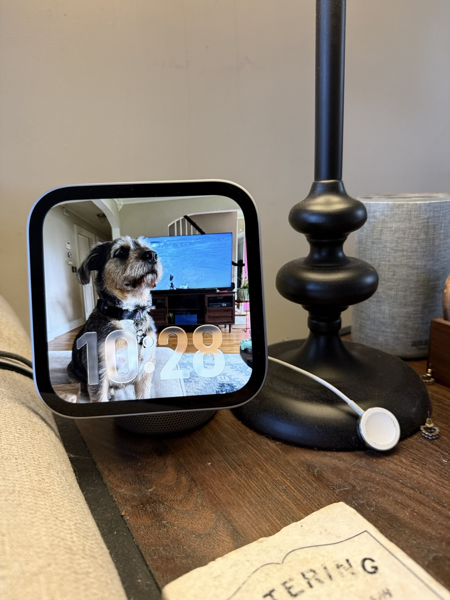
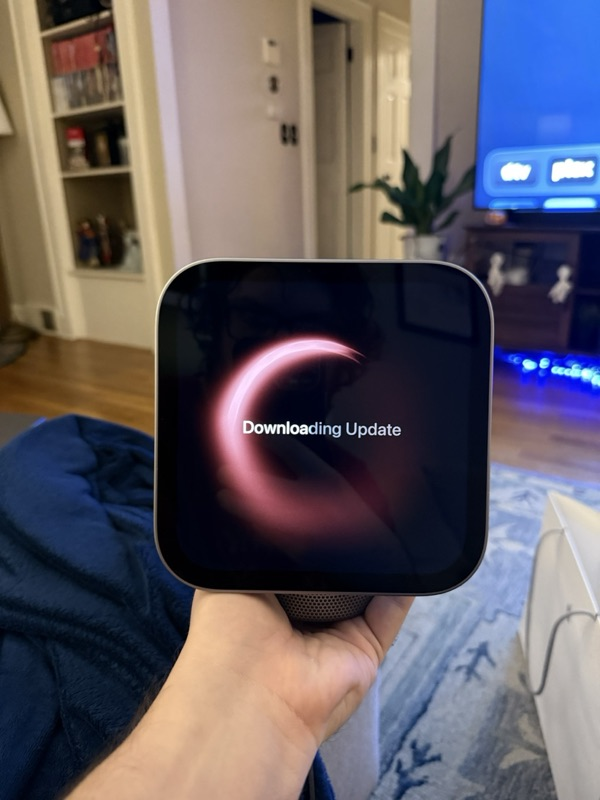
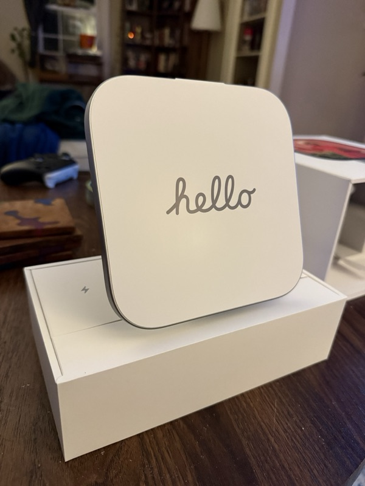

<figure class="post-hero" style="--hero-image: url('/images/11-26/homeview1.jpeg');">
  
</figure>

## Design and Setup

The hardware is gorgeous, as expected. I've seen a lot of people say that its smaller than expected, but I actually think its the perfect size for a device like this. The biggest challenge so far? Figuring out the best spot for it in my home.

I wish I had more control over the brightness of the screen. For right now I've put my HomeView on my living room side table, but it sees me and keeps the screen on 24/7 and I'm finding it a little distracting to have lit all the time. I'd like for the screen to turn off or dim to very, very low brightness unless I'm directly interacting with it, or maybe standing right in front of it about to, or something.

## Sound Quality

The sound quality is phenomenal, it’s louder and has much more bass than my old Amazon Echo, which was my previous living room speaker. I'm not exactly an audiophile - in fact, being hard of hearing, you could say I'm far from it - but my impression is that this will make for a great house party speaker.

## Siri and Smart Features

I been using Siri, but things got a bit frustrating. When I asked, “Hey Siri, add X to my groceries list,” I got a “I cant add to lists right now.” Even though the hardware is stunning, Siri needs to step up its game. One of the very first things I tried was setting a timer, and it replied, “I need a software update before I can set timers” - a problem that was fixed after a reboot.

Basic tasks are also much, much slower than my Echo with Alexa Plus. It has no problem turning on and off lights, the thermostat, etc - but my Echo does all of that twice as fast. Right now I have both devices side by side, and my partner has already insisted that the Echo isn't going anywhere anytime fast. Drat!

## Streaming Third-Party Apps

Third-party apps streamed from my iPhone look great and work, but they’re slow, kind of like first-generation third-party Apple Watch apps. I don't think this device needs an App Store, but I’d love if my iPhone or iPad could send real apps directly to the HomeView instead of relying on streaming them.

## Final Thoughts

The HomeView is a stunning piece of hardware with a great screen, and I love seeing the photos the Photos face surfaces. But until Siri AI and the software it runs improves, I’m keeping my expectations realistic. This is far from a must-have device in its current state, but if you live in the Apple ecosystem and have built an Apple Home smarthome ecosystem as I have, its a fun toy to play with, and a worthwhile purchase if you don't mind sticking through some growing pains and rough edges.

## Photos

  <figure class="photo-thumb">
    
    <figcaption>The HomeView requires a lengthy update at first run before it can be used.</figcaption>
  </figure>
  <figure class="photo-thumb">
    
    <figcaption>The hello sticker on the display when unboxing is a nice touch!</figcaption>
  </figure>

